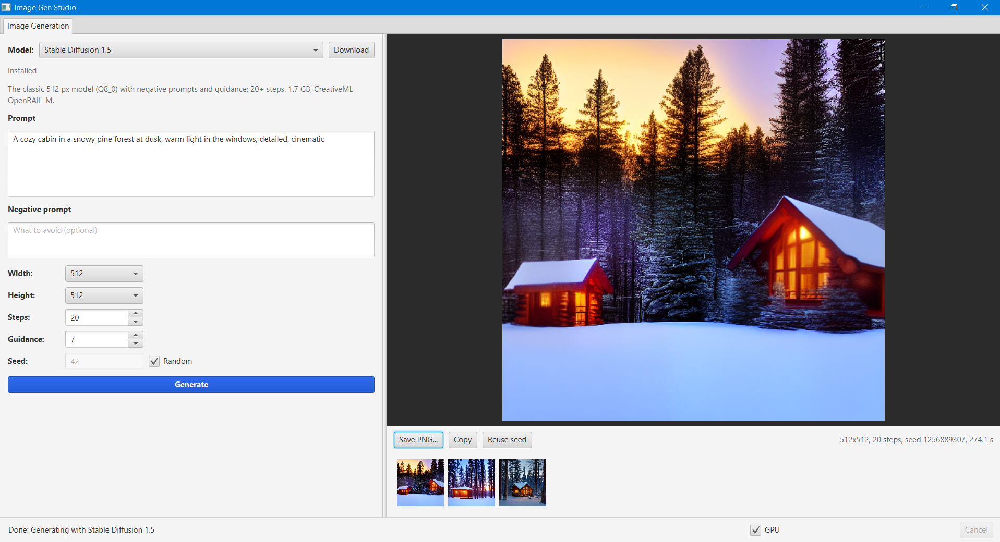

# Image Gen Studio

A JavaFX desktop app for local, offline image generation with models that run on a CPU or a small GPU. Each image task gets its own tab, and each tab has a model selector:



| Tab | Service interface | Implementations |
| --- | --- | --- |
| Image Generation | `ImageGenerationService` | `SdCppImageGenerationService` (stable-diffusion.cpp), `OnnxImageGenerationService` (ONNX Runtime) |
| Image Editing *(planned)* | — | — |

The tab shows a live preview while sampling. Finished images can be saved as PNG, copied to the clipboard, or regenerated with the same seed, and earlier results stay in a history strip.

## Models and licenses

Models are listed roughly from fastest to slowest:

| Model | Backend | Source | Download | Default steps | License |
| --- | --- | --- | --- | --- | --- |
| [SDXS-512 DreamShaper](https://huggingface.co/IDKiro/sdxs-512-dreamshaper) | sd.cpp | [akleine/sdxs-512](https://huggingface.co/akleine/sdxs-512) | 0.9 GB | 1 | OpenRAIL++ |
| [Stable Diffusion 1.5](https://huggingface.co/stable-diffusion-v1-5/stable-diffusion-v1-5) + [LCM-LoRA](https://huggingface.co/latent-consistency/lcm-lora-sdv1-5) | sd.cpp | [Q8_0 GGUF](https://huggingface.co/second-state/stable-diffusion-v1-5-GGUF) | 1.8 GB | 4 | CreativeML OpenRAIL-M (LoRA: OpenRAIL++) |
| [LCM Dreamshaper v7](https://huggingface.co/SimianLuo/LCM_Dreamshaper_v7) | ONNX Runtime | [ONNX export](https://huggingface.co/TheyCallMeHex/LCM-Dreamshaper-V7-ONNX) | 4.1 GB | 4 | MIT |
| Stable Diffusion 1.5 | sd.cpp | Q8_0 GGUF (shared with the LCM entry) | 1.7 GB | 20 | CreativeML OpenRAIL-M |
| [SD-Turbo](https://huggingface.co/stabilityai/sd-turbo) | sd.cpp | [GGUF](https://huggingface.co/Green-Sky/SD-Turbo-GGUF) | 1.9 GB | 2 | **Stability AI Community License** (commercial use needs a license above $1M annual revenue) |
| [PixArt-Σ 512](https://huggingface.co/PixArt-alpha/PixArt-Sigma-XL-2-512-MS) | sd.cpp | Official safetensors + [T5-XXL Q4_K_M](https://huggingface.co/city96/t5-v1_1-xxl-encoder-gguf) | 5.3 GB | 20 | OpenRAIL++ (T5: Apache 2.0) |
| [PixArt-α 512](https://huggingface.co/PixArt-alpha/PixArt-XL-2-512x512) | sd.cpp | Official safetensors + T5-XXL Q4_K_M (shared) | 5.1 GB | 20 | OpenRAIL++ |
| [FLUX.2 \[klein\] 4B](https://huggingface.co/black-forest-labs/FLUX.2-klein-4B) | sd.cpp | [Q4_0 GGUF](https://huggingface.co/leejet/FLUX.2-klein-4B-GGUF) + [Qwen3-4B Q4_K_M](https://huggingface.co/unsloth/Qwen3-4B-GGUF) | 4.9 GB | 4 | Apache 2.0 |
| [FLUX.1 \[schnell\]](https://huggingface.co/black-forest-labs/FLUX.1-schnell) | sd.cpp | [Q3_K GGUF](https://huggingface.co/leejet/FLUX.1-schnell-gguf) + CLIP-L + T5-XXL Q4_K_M | 8.1 GB | 4 | Apache 2.0 |
| [Z-Image-Turbo](https://huggingface.co/Tongyi-MAI/Z-Image-Turbo) | sd.cpp | [Q3_K GGUF](https://huggingface.co/leejet/Z-Image-Turbo-GGUF) + Qwen3-4B-Instruct Q4_K_M | 5.6 GB | 8 | Apache 2.0 |

Files that several models use (SD 1.5, T5-XXL, the FLUX VAE) are downloaded only once. Every repository is ungated, so no Hugging Face token is needed. Check each license before commercial use.

What has been verified end-to-end (on an i7-11800H CPU, 512×512):

| Model | Result |
| --- | --- |
| SDXS-512 | ~5.5 s per image |
| SD 1.5 + LCM-LoRA | ~47 s for 4 steps |
| LCM Dreamshaper v7 (ONNX) | ~30 s including model load (4 steps) |
| Image Generation tab | Clicking Generate shows an SDXS image (UI test) |

The other catalog entries use files whose existence and sizes were checked on Hugging Face, plus the sd.cpp options documented for them. They are too large to run in CI.

Other components:

| Component | Purpose | License |
| --- | --- | --- |
| [stable-diffusion.cpp](https://github.com/leejet/stable-diffusion.cpp) | Runs GGUF/safetensors models (downloaded prebuilt `sd-cli`) | MIT |
| [ONNX Runtime](https://onnxruntime.ai/) for Java | Runs the ONNX pipeline | MIT |
| DirectML ([Microsoft.AI.DirectML](https://www.nuget.org/packages/Microsoft.AI.DirectML)) | Optional GPU runtime for ONNX (downloaded) | Microsoft DirectML license (redistributable) |
| JavaFX | UI | GPL 2.0 with Classpath Exception |
| Guice, Jackson | DI, JSON | Apache 2.0 |

## No extra installs

You only need Java 17+ and Maven. There is no Python, PyTorch, CUDA or separate runtime to install.

- **stable-diffusion.cpp backend.** The first time an sd.cpp model is used, the app downloads the matching prebuilt `sd-cli` release (~30 MB) from GitHub and runs it as a subprocess:
  - Windows x64: CPU (AVX2) or Vulkan
  - Linux x64: CPU or Vulkan
  - macOS arm64: Metal

  Progress, live previews (`--preview proj`, decoded from latents) and errors are parsed from its output. Cancelling kills the process.
- **ONNX backend.** This is an in-process Stable Diffusion pipeline written in pure Java. It includes:
  - a CLIP BPE tokenizer
  - LCM and Euler-ancestral schedulers, ported from diffusers
  - classifier-free guidance
  - latent previews
- Model files are downloaded from Hugging Face the first time each model is used. They are cached in `~/.image-gen/models`. Interrupted downloads resume where they stopped.

## GPU acceleration (optional)

Turn on **GPU** in the status bar. The setting is saved in `~/.image-gen/settings.properties`.

- **sd.cpp models** switch to the Vulkan build of `sd-cli` (Windows and Linux), which works on NVIDIA, AMD and Intel GPUs without CUDA. It is downloaded the first time. On macOS, Metal is always used.
- **ONNX models** use DirectML on Windows x64 (any DirectX 12 GPU). The DirectML build of ONNX Runtime (~15 MB) is downloaded the first time, and the app may need a restart.
- With 4 GB of VRAM, prefer SDXS, SD 1.5 (+LCM) or SD-Turbo. The transformer models (PixArt, FLUX, Z-Image) need 6–8 GB or more, or run on the CPU with 16 GB+ of RAM.

## Configuration

| System property | Default | Purpose |
| --- | --- | --- |
| `imagegen.models` | `~/.image-gen/models` | Model cache directory (also forwarded by `mvn javafx:run` and the tests) |
| `imagegen.device` | saved setting | `gpu` or `cpu`; overrides the GPU checkbox |
| `imagegen.gpu.device` | high-performance GPU | DirectML adapter index |
| `imagegen.sdcpp.path` | downloaded release | Path to your own `sd-cli` executable (for example a CUDA build) |
| `imagegen.hf.endpoint` | `https://huggingface.co` | Hugging Face mirror |
| `imagegen.integration` | `false` | Enables the model integration tests |

## Run

```
mvn javafx:run
mvn javafx:run -Dimagegen.models=D:\image-gen-models   # custom model cache
```

To build a self-contained jar:

```
mvn package
java -jar target/image-gen-*-jar-with-dependencies.jar
```

## Tests

```
mvn verify                                                         # unit tests
mvn test -Dtest=ModelsIntegrationTest -Dimagegen.integration=true  # real models
mvn test -Dtest=GenerationTabIntegrationTest -Dimagegen.integration=true  # clicks Generate in the real window
```

The integration tests download the models they need:

- SDXS, SD 1.5 + LCM-LoRA and LCM Dreamshaper ONNX (~7 GB in total)
- a tiny ONNX test model

They write the generated images to `target/integration-images`.

## Structure

The project setup follows [stt-tts](https://github.com/TalaatHarb/stt-tts):

- Guice `AppModule` and FXML controllers created through `injector::getInstance`.
- Single-instance lock and system tray.
- GitHub build and release workflows.

```
net.talaatharb.imagegen
├── ImageGenApp / ImageGenLauncher / ApplicationTray / SingleInstance
├── config/                       AppModule (service list, model store), AppSettings (saved preferences)
├── service/                      ImageGenerationService + request/result/defaults records
├── generation/sdcpp/             stable-diffusion.cpp: platform builds, engine process, output parser, model catalog
├── generation/onnx/              ONNX Runtime pipeline: CLIP tokenizer, LCM/Euler-a schedulers, model catalog
├── image/                        tensor <-> image conversion, latent previews
├── model/                        Hugging Face downloader (resumable), model cache, ONNX helpers, DirectML runtime
└── ui/                           main window, Image Generation tab, background task runner
```

To add a new image task, add a service interface in `service/`, an FXML tab plus a controller in `ui/`, and a `<Tab>` in `main.fxml`.

## Roadmap (future work)

- [ ] **Image Editing tab.** img2img, inpainting and instruction editing. sd.cpp already supports `--init-img`, `--mask` and reference images (FLUX.2 [klein] and FLUX.1 Kontext), so most of the work is UI.
- [ ] **Upscaling tab.** Real-ESRGAN is supported by sd.cpp (`--upscale-model`). It could also run as a small ONNX model.
- [ ] **Würstchen v2 / Stable Cascade (Stage B/C).** Not implemented:
  - stable-diffusion.cpp doesn't support the architecture.
  - There is no maintained ONNX export.
  - Stable Cascade uses the non-commercial Stability AI license.

  Running it would need custom ONNX exports of the three stages plus a Java port of its sampler.
- [ ] **NF4 (bitsandbytes) checkpoints.** These need Python and CUDA, so the GGUF quantizations (Q3_K–Q8_0) are used instead. They are similar in size and run on the CPU.
- [ ] **FLUX.2 [klein] 9B.** Better quality, but **non-commercial license** and ~6 GB+ quantized.
- [ ] **More ONNX models.** SD-Turbo / SDXL-Turbo ONNX exports with the existing Euler-a scheduler (`timestep_spacing = trailing`), and fp16 exports for DirectML.
- [ ] **LoRA picker.** sd.cpp loads any LoRA via `<lora:name:weight>`.
