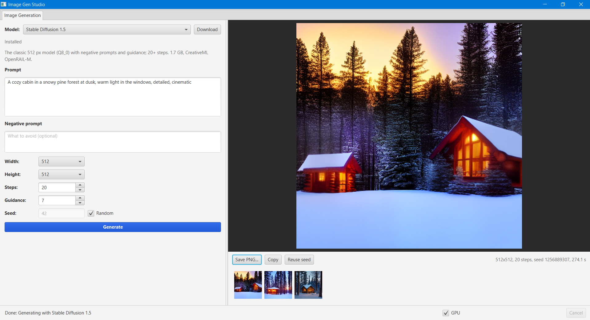

# Image Gen Studio

A JavaFX desktop app for local, offline image generation with models that run on a CPU or a small GPU. Each image task gets its own tab, and each tab has a model selector:



| Tab | Service interface | Implementations |
| --- | --- | --- |
| Image Generation | `ImageGenerationService` | `SdCppImageGenerationService` (stable-diffusion.cpp), `OnnxImageGenerationService` (ONNX Runtime) |
| Image Editing | `ImageEditingService` | `SdCppImageEditingService` (SD 1.5 img2img/inpainting, FLUX.2 Klein instruction editing) |
| Upscaling | `ImageUpscalingService` | `SdCppUpscalingService` (Real-ESRGAN 4x) |

The tab shows a live preview while sampling. Finished images can be saved as PNG, copied to the clipboard, or regenerated with the same seed, and earlier results stay in a history strip.

## Models and licenses

Models are listed roughly from fastest to slowest:

| Model | Backend | Source | Download | Default steps | License |
| --- | --- | --- | --- | --- | --- |
| [SDXS-512 DreamShaper](https://huggingface.co/IDKiro/sdxs-512-dreamshaper) | sd.cpp | [akleine/sdxs-512](https://huggingface.co/akleine/sdxs-512) | 0.9 GB | 1 | OpenRAIL++ |
| [Stable Diffusion 1.5](https://huggingface.co/stable-diffusion-v1-5/stable-diffusion-v1-5) + [LCM-LoRA](https://huggingface.co/latent-consistency/lcm-lora-sdv1-5) | sd.cpp | [Q8_0 GGUF](https://huggingface.co/second-state/stable-diffusion-v1-5-GGUF) | 1.8 GB | 4 | CreativeML OpenRAIL-M (LoRA: OpenRAIL++) |
| [LCM Dreamshaper v7](https://huggingface.co/SimianLuo/LCM_Dreamshaper_v7) | ONNX Runtime | [ONNX export](https://huggingface.co/TheyCallMeHex/LCM-Dreamshaper-V7-ONNX) | 4.1 GB | 4 | MIT |
| Stable Diffusion 1.5 | sd.cpp | Q8_0 GGUF (shared with the LCM entry) | 1.7 GB | 20 | CreativeML OpenRAIL-M |
| [SD-Turbo](https://huggingface.co/stabilityai/sd-turbo) | sd.cpp | [GGUF](https://huggingface.co/Green-Sky/SD-Turbo-GGUF) | 1.9 GB | 2 | **Stability AI Community License** (commercial use needs a license above $1M annual revenue) |
| [PixArt-Σ 512](https://huggingface.co/PixArt-alpha/PixArt-Sigma-XL-2-512-MS) | sd.cpp | Official safetensors + [T5-XXL Q4_K_M](https://huggingface.co/city96/t5-v1_1-xxl-encoder-gguf) | 5.3 GB | 20 | OpenRAIL++ (T5: Apache 2.0) |
| [PixArt-α 512](https://huggingface.co/PixArt-alpha/PixArt-XL-2-512x512) | sd.cpp | Official safetensors + T5-XXL Q4_K_M (shared) | 5.1 GB | 20 | OpenRAIL++ |
| [FLUX.2 \[klein\] 4B](https://huggingface.co/black-forest-labs/FLUX.2-klein-4B) | sd.cpp | [Q4_0 GGUF](https://huggingface.co/leejet/FLUX.2-klein-4B-GGUF) + [Qwen3-4B Q4_K_M](https://huggingface.co/unsloth/Qwen3-4B-GGUF) | 4.9 GB | 4 | Apache 2.0 |
| [FLUX.1 \[schnell\]](https://huggingface.co/black-forest-labs/FLUX.1-schnell) | sd.cpp | [Q3_K GGUF](https://huggingface.co/leejet/FLUX.1-schnell-gguf) + CLIP-L + T5-XXL Q4_K_M | 8.1 GB | 4 | Apache 2.0 |
| [Z-Image-Turbo](https://huggingface.co/Tongyi-MAI/Z-Image-Turbo) | sd.cpp | [Q3_K GGUF](https://huggingface.co/leejet/Z-Image-Turbo-GGUF) + Qwen3-4B-Instruct Q4_K_M | 5.6 GB | 8 | Apache 2.0 |

Files that several models use (SD 1.5, T5-XXL, the FLUX VAE) are downloaded only once. Every repository is ungated, so no Hugging Face token is needed. Check each license before commercial use.

What has been verified end-to-end (on an i7-11800H CPU, 512×512):

| Model | Result |
| --- | --- |
| SDXS-512 | ~5.5 s per image |
| SD 1.5 + LCM-LoRA | ~47 s for 4 steps |
| LCM Dreamshaper v7 (ONNX) | ~30 s including model load (4 steps) |
| Image Generation tab | Clicking Generate shows an SDXS image (UI test) |

The other catalog entries use files whose existence and sizes were checked on Hugging Face, plus the sd.cpp options documented for them. They are too large to run in CI.

Other components:

| Component | Purpose | License |
| --- | --- | --- |
| [stable-diffusion.cpp](https://github.com/leejet/stable-diffusion.cpp) | Runs GGUF/safetensors models (downloaded prebuilt `sd-cli`) | MIT |
| [ONNX Runtime](https://onnxruntime.ai/) for Java | Runs the ONNX pipeline | MIT |
| DirectML ([Microsoft.AI.DirectML](https://www.nuget.org/packages/Microsoft.AI.DirectML)) | Optional GPU runtime for ONNX (downloaded) | Microsoft DirectML license (redistributable) |
| JavaFX | UI | GPL 2.0 with Classpath Exception |
| Guice, Jackson | DI, JSON | Apache 2.0 |

## No extra installs

You only need Java 17+ and Maven. There is no Python, PyTorch, CUDA or separate runtime to install.

- **stable-diffusion.cpp backend.** The first time an sd.cpp model is used, the app downloads the matching prebuilt `sd-cli` release (~30 MB) from GitHub and runs it as a subprocess:
  - Windows x64: CPU (AVX2) or Vulkan
  - Linux x64: CPU or Vulkan
  - macOS arm64: Metal

  Progress, live previews (`--preview proj`, decoded from latents) and errors are parsed from its output. Cancelling kills the process.
- **ONNX backend.** This is an in-process Stable Diffusion pipeline written in pure Java. It includes:
  - a CLIP BPE tokenizer
  - LCM and Euler-ancestral schedulers, ported from diffusers
  - classifier-free guidance
  - latent previews
- Model files are downloaded from Hugging Face the first time each model is used. They are cached in `~/.image-gen/models`. Interrupted downloads resume where they stopped.

## GPU acceleration (optional)

Turn on **GPU** in the status bar. The setting is saved in `~/.image-gen/settings.properties`.

- **sd.cpp models** switch to the Vulkan build of `sd-cli` (Windows and Linux), which works on NVIDIA, AMD and Intel GPUs without CUDA. It is downloaded the first time. On macOS, Metal is always used.
- **ONNX models** use DirectML on Windows x64 (any DirectX 12 GPU). The DirectML build of ONNX Runtime (~15 MB) is downloaded the first time, and the app may need a restart.
- With 4 GB of VRAM, prefer SDXS, SD 1.5 (+LCM) or SD-Turbo. The transformer models (PixArt, FLUX, Z-Image) need 6–8 GB or more, or run on the CPU with 16 GB+ of RAM.

## Local MCP server (optional)

The **MCP** toggle beside GPU starts a Streamable HTTP MCP endpoint at
`http://127.0.0.1:8764/mcp`. It is **off on every startup**, even if it was enabled
last time. Turning it off or exiting the app stops the listener and cancels its active generation.

Use **MCP settings...** while the server is off to change its port and default model.
The system tray menu also has an **MCP server** checkbox and **MCP settings...**.
Tray and window toggles stay synchronized; settings are disabled in both while MCP is running.
The initial model is **Stable Diffusion 1.5 + LCM-LoRA** (`sd15-lcm`). These preferences
are saved as `mcp.port` and `mcp.model` in `~/.image-gen/settings.properties`.

Connect an MCP client using its Streamable HTTP URL setting. Available tools:

| Tool | Arguments | Result |
| --- | --- | --- |
| `list_models` | None | Model IDs, installed status, supported sizes and generation defaults |
| `generate_image` | Required `prompt`; optional `model`, `negative_prompt`, `width`, `height`, `steps`, `guidance_scale`, `seed` | Base64 PNG image content plus model, dimensions, elapsed time and the actual seed |
| `edit_image` | Required base64 `image` and `prompt`; `mask` required for inpainting; optional `mode`, `model`, `strength` and generation settings | Edited PNG and generation metadata |
| `upscale_image` | Required base64 `image`; optional `model`, `tile_size` | 4x PNG with dimensions, scale and elapsed time |

Omitted generation settings use the chosen model's defaults; `seed` defaults to `-1`
(random). Optional values may also be null, empty/whitespace, or `"default"` (case-insensitive).
Numeric strings are accepted. Invalid optional values or unknown models fall back to defaults;
unsupported negative prompts/guidance and extra arguments are ignored. Corrections are reported
in the result metadata's `warnings` array. A nonblank string `prompt` (up to 8192 characters)
is still required, and transport, unavailable-model, busy and runtime errors remain errors.
For example, call `generate_image` with `{"prompt":"a fox in a meadow","model":"default","seed":42}`.
`list_models` also lists editing capabilities, upscalers and their configured defaults.

Image tools accept **base64 PNG/JPEG bytes**, optionally as `data:image/png;base64,...`
or `data:image/jpeg;base64,...`; they do not accept filesystem paths or fetch URLs.
Each input file is limited to 8 MiB and 16 megapixels. Image requests may be up to 24 MiB;
non-image requests remain limited to 64 KiB. Upscaled output is limited to 16 megapixels.
Invalid input images and missing/mismatched inpainting masks are essential errors.

The settings window (also available from the tray) includes these persistent defaults:

| Setting | Initial value |
| --- | --- |
| Img2img / inpainting model | SD 1.5 (`sd15`) |
| Instruction model | FLUX.2 Klein 4B (`flux2-klein-4b`) |
| Editing mode | `img2img` |
| Editing strength | `0.75` |
| Upscaling model | Real-ESRGAN x4plus (`realesrgan-x4plus`) |
| Upscaling tile size | `128` |

For example, `edit_image` takes `{"image":"<base64 PNG>","prompt":"make this a watercolor","mode":"img2img"}`
and `upscale_image` takes `{"image":"<base64 PNG>","model":"default"}`.
Download the desired model in the app first; MCP will report a missing-model error rather
than initiate a large model download. GPU mode applies to MCP generation too (a missing
GPU executable may still be downloaded). UI and MCP requests share one worker; a busy
app returns a tool error. The status bar shows remote progress and **Cancel** cancels it.

The server binds explicitly to **127.0.0.1**, never a wildcard address. Host and Origin
headers are checked against localhost and the configured port, and no CORS access is
enabled. It has no authentication: only enable it while trusted local clients need access.
It supports stateless JSON responses (MCP 2025-03-26, 2025-06-18 and 2025-11-25), not
legacy HTTP+SSE, server-push streams or client cancellation notifications. Clients should
allow enough time for CPU inference, which can take minutes.

## Configuration

| System property | Default | Purpose |
| --- | --- | --- |
| `imagegen.models` | `~/.image-gen/models` | Model cache directory (also forwarded by `mvn javafx:run` and the tests) |
| `imagegen.device` | saved setting | `gpu` or `cpu`; overrides the GPU checkbox |
| `imagegen.gpu.device` | high-performance GPU | DirectML adapter index |
| `imagegen.sdcpp.path` | downloaded release | Path to your own `sd-cli` executable (for example a CUDA build) |
| `imagegen.hf.endpoint` | `https://huggingface.co` | Hugging Face mirror |
| `imagegen.integration` | `false` | Enables the model integration tests |

## Editing and upscaling

**Image Editing** loads an input PNG/JPEG, offers mode-compatible models, and lets you
choose the prompt/instruction, output dimensions, steps, guidance, strength and seed.
Img2img and inpainting resize the input to the chosen output dimensions (stretch).
For inpainting, load a same-size mask: white edits, black preserves, gray blends.
Alternatively, use **Draw mask...** to paint over the input image with an adjustable
brush, eraser and Clear mask action. The red overlay marks the region to edit.
Loaded masks can also be modified; **Use mask** applies changes and Cancel discards them.
Drawing always produces a mask matching the original input dimensions. MCP still
requires callers to supply the input image and mask for inpainting.
Black-mask pixels are preserved after VAE decoding as well as during sampling.
Instruction editing uses the original image as a FLUX.2 Klein reference; strength is not used.
SD 1.5 and SD 1.5 + LCM share the already-downloaded generation checkpoints.

**Upscaling** offers [Real-ESRGAN x4plus](https://github.com/xinntao/Real-ESRGAN)
(general, ~64 MiB) and x4plus anime 6B (small, ~17 MiB), both BSD-3-Clause.
These official `.pth` weights run directly through the installed sd.cpp executable
in standalone upscale mode; no diffusion checkpoint or Python is needed.
Upscaling is fixed at 4x; smaller tiles reduce memory use. Model files are cached
under `~/.image-gen/models/upscalers`.

Both tabs support Save PNG, Copy and Use as input, share the same cancellable worker
with generation/MCP, and follow the GPU switch. UI downloads ask for confirmation;
MCP requires the selected model to be installed first.

Img2img, inpainting and Real-ESRGAN have been run on CPU, including through HTTP MCP.
FLUX.2 Klein instruction editing is wired to sd.cpp's `--ref-image` and covered by
argument/capability tests, but has **not** been run end-to-end here (multi-GB download).
FLUX.1 Kontext and an ONNX upscaler remain future additions.

## Run

```
mvn javafx:run
mvn javafx:run -Dimagegen.models=D:\image-gen-models   # custom model cache
```

To build a self-contained jar:

```
mvn package
java -jar target/image-gen-*-jar-with-dependencies.jar
```

## Tests

```
mvn verify                                                         # unit tests
mvn test -Dtest=ModelsIntegrationTest -Dimagegen.integration=true  # real models
mvn test -Dtest=GenerationTabIntegrationTest -Dimagegen.integration=true  # MCP + Generate in the real window
mvn test -Dtest=TrayIntegrationTest -Dimagegen.integration=true  # native tray controls (run separately)
mvn test -Dtest=ImageTasksIntegrationTest -Dimagegen.integration=true  # real editing/upscaling backends
mvn test -Dtest=ImageTasksMcpIntegrationTest -Dimagegen.integration=true  # new tabs + HTTP tools (run separately)
```

The integration tests download the models they need:

- SDXS, SD 1.5 + LCM-LoRA and LCM Dreamshaper ONNX (~7 GB in total)
- a tiny ONNX test model

They write the generated images to `target/integration-images`.
The window test also exercises the MCP toggle, busy errors and cancellation, then generates
with SD 1.5 + LCM over HTTP. That model must already be downloaded.
The image-task tests download only SD 1.5 and Real-ESRGAN if missing, not FLUX.
The HTTP test writes `mcp-edit-default.png`, `mcp-edit-inpaint.png`, and `mcp-upscaled.png`
to `target/integration-images`. Run JavaFX window/tray integration classes separately,
since a JavaFX toolkit can only be started once per JVM.

## Structure

The project setup follows [stt-tts](https://github.com/TalaatHarb/stt-tts):

- Guice `AppModule` and FXML controllers created through `injector::getInstance`.
- Single-instance lock and system tray.
- GitHub build and release workflows.

```
net.talaatharb.imagegen
├── ImageGenApp / ImageGenLauncher / ApplicationTray / SingleInstance
├── config/                       AppModule (service list, model store), AppSettings (saved preferences)
├── service/                      ImageGenerationService + request/result/defaults records
├── generation/sdcpp/             stable-diffusion.cpp: generation/editing, Real-ESRGAN, engine, parser, catalog
├── generation/onnx/              ONNX Runtime pipeline: CLIP tokenizer, LCM/Euler-a schedulers, model catalog
├── image/                        tensor <-> image conversion, latent previews
├── model/                        Hugging Face downloader (resumable), model cache, ONNX helpers, DirectML runtime
├── mcp/                          localhost-only HTTP MCP tools, using the shared generation worker
└── ui/                           generation/editing/upscaling tabs, settings, shared background worker
```

To add a new image task, add a service interface in `service/`, an FXML tab plus a controller in `ui/`, and a `<Tab>` in `main.fxml`.

## Roadmap (future work)

- [ ] **Editing improvements.** Support crop/fit preprocessing and add FLUX.1 Kontext models.
- [ ] **More upscalers.** Add small ONNX upscalers, alternative scale factors and configurable output limits.
- [ ] **Würstchen v2 / Stable Cascade (Stage B/C).** Not implemented:
  - stable-diffusion.cpp doesn't support the architecture.
  - There is no maintained ONNX export.
  - Stable Cascade uses the non-commercial Stability AI license.

  Running it would need custom ONNX exports of the three stages plus a Java port of its sampler.
- [ ] **NF4 (bitsandbytes) checkpoints.** These need Python and CUDA, so the GGUF quantizations (Q3_K–Q8_0) are used instead. They are similar in size and run on the CPU.
- [ ] **FLUX.2 [klein] 9B.** Better quality, but **non-commercial license** and ~6 GB+ quantized.
- [ ] **More ONNX models.** SD-Turbo / SDXL-Turbo ONNX exports with the existing Euler-a scheduler (`timestep_spacing = trailing`), and fp16 exports for DirectML.
- [ ] **LoRA picker.** sd.cpp loads any LoRA via `<lora:name:weight>`.
